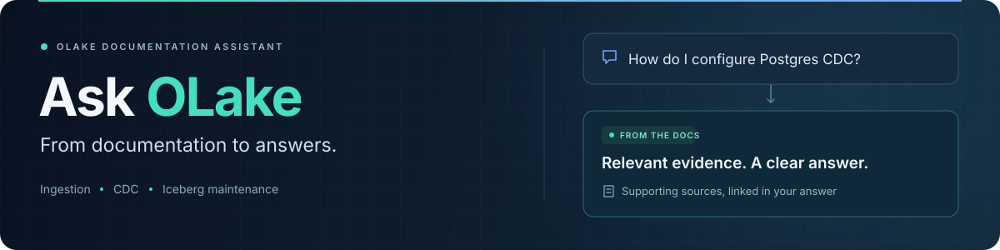

<p align="center">
  
</p>

<p align="center">
  
  
  
  
</p>

<p align="center">
  <strong>Ask about OLake. Get an answer you can trace.</strong><br>
  A documentation assistant for ingestion, CDC, and Iceberg table maintenance.
</p>

<p align="center">
  <a href="#quick-start">Quick start</a> ·
  <a href="#try-it">Try it</a> ·
  <a href="#api-at-a-glance">API</a> ·
  <a href="docs/OPERATIONS.md#deploy">Deploy</a> ·
  <a href="docs/OPERATIONS.md">Operations guide</a>
</p>

---

| 🔎 Find the right context | 🔗 Follow the sources | 🔄 Keep docs fresh |
| --- | --- | --- |
| Hybrid search across OLake docs and repositories. | Answers link back to supporting passages. | Optional GitHub Actions refresh every three hours. |

## Quick start

**You'll need:** Python 3.11+, [uv](https://docs.astral.sh/uv/), Git, Qdrant Cloud, and an OpenRouter key.

For a new setup, copy [.env.example](.env.example) to `.env` and fill in
`OPENROUTER_API_KEY`, `QDRANT_URL`, and `QDRANT_API_KEY`. Keep an existing configured `.env`.

With an index available in your configured Qdrant collection, run:

```sh
uv sync --frozen
uv run uvicorn app.main:app --reload --port 8080
```

Open **[localhost:8080/docs](http://localhost:8080/docs)** to try the API.

<details>
<summary><strong>First setup? Build an index</strong></summary>

Install dependencies with `uv sync --frozen`, then run these commands before starting
the API. Skip this step if you already have a usable index.

```sh
uv run python -m ingest.crawl docs
uv run python -m ingest.crawl repos
uv run python -m ingest.build_index
```

Let any existing build finish before starting another. Your first local run also
downloads the CPU models.

</details>

## Try it

Ask a question from PowerShell:

```powershell
Invoke-RestMethod -Uri "http://localhost:8080/ask" `
  -Method Post -ContentType "application/json" `
  -Body '{"question":"How do I configure a Postgres source for CDC?"}'
```

The response contains **`answer`** and **`sources`**. If a setup choice is missing,
the assistant can ask a clarification; if the evidence is insufficient, it declines to guess.

## Render CPU tuning

The API defaults to `INFERENCE_THREADS=1` and `RERANK_BATCH_SIZE=2` to limit CPU
thread contention and peak reranking memory. These optional environment variables
apply after restarting or redeploying the API. The embedding and reranking models,
token limits and Qdrant index stay the same; no reindexing is needed.
Quantized reranker scores can vary with batch size; review returned evidence when
changing this setting.

For a small Render instance, keep `WEB_CONCURRENCY=1` and
`RETRIEVAL_CONCURRENCY=1`. The reduced-load deployment also uses `CANDIDATES=8`,
`TOP_K=6` and `RETRIEVAL_RECOVERY_ENABLED=false`; reducing candidates and disabling
recovery can reduce evidence coverage. No particular free-tier latency is guaranteed.

Logs report `retrieval stage=queue`, `embedding_dense`, `embedding_sparse`,
`qdrant`, `rerank_local` and `rerank_external` durations in seconds. Compare these
with `LLM attempt=... elapsed_s=...` and `ask seconds=...` for an uncached request.
An exact repeated question can return `X-Cache: HIT` and skip inference.

## API at a glance

| Route | What you get |
| --- | --- |
| `POST /ask` | An answer with source links. |
| `GET /readyz` | Index and configuration readiness. |
| `GET /models` | Available models in fallback order. |
| `GET /version` | Render commit and running instance identifiers. |

<p align="center">
  <sub>OLake documentation → relevant evidence → answers with sources.</sub>
</p>
